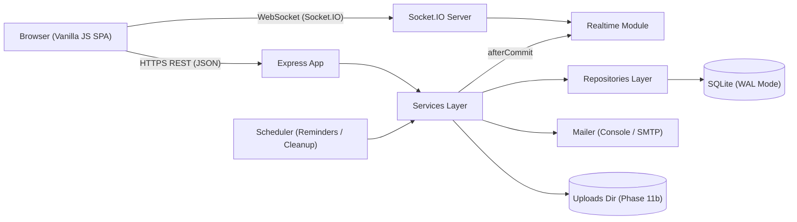

# System Architecture

**Status:** Design only.  
**Related:** [DATABASE.md](file:///e:/projectanagement/docs/DATABASE.md), [API.md](file:///e:/projectanagement/docs/API.md), [WEBSOCKET.md](file:///e:/projectanagement/docs/WEBSOCKET.md), [SECURITY.md](file:///e:/projectanagement/docs/SECURITY.md), [DESIGN.md](file:///e:/projectanagement/docs/DESIGN.md).

---

## 1. Principles

1. One deployable Node process, one SQLite file, one set of static assets.
2. Writes only through REST; sockets push events post-commit.
3. Strict layering: Routes parse/respond; services own business rules, authorization, and transactions; repositories own SQL.
4. Server is the sole authority for permissions, IDs, and ordering.
5. Vanilla JavaScript with ES modules on frontend; zero bundlers, no heavy frameworks.

---

## 2. Architecture Diagram



---

## 3. Directory Structure

```
teamboard/
├── package.json
├── .env.example
├── .gitignore
├── server/
│   ├── index.js                  # Bootstrap (config, db, http server, io, jobs, shutdown)
│   ├── app.js                    # createApp(): middleware pipeline, routes, error handling
│   ├── config.js                 # Environment validation (Zod)
│   ├── logger.js                 # Structured JSON logger with request IDs
│   ├── db/
│   │   ├── index.js              # Database connection, pragmas, transactions, afterCommit
│   │   ├── migrate.js            # Migration runner
│   │   └── migrations/           # 001_identity.sql .. 008_extras.sql
│   ├── middleware/
│   │   ├── requestId.js
│   │   ├── securityHeaders.js
│   │   ├── originCheck.js
│   │   ├── session.js
│   │   ├── csrf.js
│   │   ├── rateLimit.js
│   │   ├── validate.js
│   │   ├── errorHandler.js
│   │   └── notFound.js
│   ├── lib/
│   │   ├── ids.js
│   │   ├── time.js
│   │   ├── position.js
│   │   ├── permissions.js
│   │   ├── errors.js
│   │   ├── tokens.js
│   │   ├── activity.js
│   │   ├── events.js             # Domain event bus
│   │   ├── mailer/
│   │   └── jobs/
│   ├── modules/                  # Domain modules (auth, users, workspaces, projects, boards, tasks, comments, notifications, dashboard)
│   │   └── <domain>/
│   │       ├── routes.js
│   │       ├── service.js
│   │       ├── repo.js
│   │       └── schema.js
│   └── realtime/
│       ├── index.js
│       ├── auth.js
│       ├── rooms.js
│       ├── presence.js
│       └── emit.js
├── public/
│   ├── index.html
│   ├── assets/css/
│   │   ├── tokens.css
│   │   ├── base.css
│   │   ├── layout.css
│   │   ├── components.css
│   │   └── pages.css
│   └── js/
│       ├── main.js
│       ├── router.js
│       ├── api.js
│       ├── store.js
│       ├── socket.js
│       ├── lib/                  # dom.js, format.js, keys.js, focus.js, dnd.js
│       ├── components/           # button, dialog, toast, column, task-card, ...
│       └── pages/                # login, register, dashboard, board, list, ...
├── data/                         # SQLite databases (gitignored)
├── uploads/                      # Attachments (gitignored)
├── tests/
│   ├── unit/
│   ├── integration/
│   ├── ws/
│   └── helpers/
└── docs/
```

---

## 4. Middleware Pipeline

```
requestId 
  → securityHeaders (Helmet + strict CSP) 
  → express.json({ limit: '100kb' }) 
  → originCheck (for mutations) 
  → static file serving (/public) 
  → session (load & refresh) 
  → csrf (verify X-CSRF-Token on mutations) 
  → rateLimit 
  → validate(schema) 
  → routeHandler 
  → errorHandler (uniform JSON envelope)
```

---

## 5. Dependency Inventory

| Package | Purpose |
| :--- | :--- |
| `express` | HTTP server and routing |
| `socket.io` | Real-time WebSockets with rooms |
| `better-sqlite3` | High-performance synchronous SQLite driver |
| `argon2` | Argon2id password hashing (fallback: Node `crypto.scrypt`) |
| `zod` | Input schema validation |
| `helmet` | Security headers baseline |
| `express-rate-limit` | Rate limiting |
| `cookie` | Cookie parsing and serialization |
| `nodemailer` | SMTP email transport |
| `multer` | Multipart uploads (Phase 11b) |
| `sortablejs` | Frontend drag-and-drop |
| `socket.io-client` | WebSocket testing (dev) |
