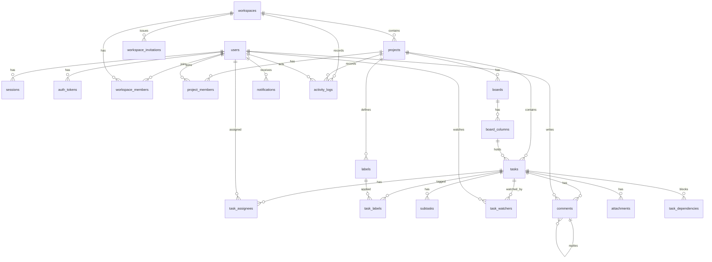

# Database Design & Schema

**Status:** Design only.  
**Related:** [ARCHITECTURE.md](file:///e:/projectanagement/docs/ARCHITECTURE.md), [API.md](file:///e:/projectanagement/docs/API.md), [SECURITY.md](file:///e:/projectanagement/docs/SECURITY.md).

---

## 1. Engine & Pragmas

SQLite via `better-sqlite3`:
```sql
PRAGMA journal_mode = WAL;
PRAGMA foreign_keys = ON;
PRAGMA busy_timeout = 5000;
PRAGMA synchronous = NORMAL;
```

---

## 2. Migrations Overview

| Migration | Phase | Tables Created |
| :--- | :--- | :--- |
| `001_identity.sql` | 1 | `schema_migrations`, `users`, `sessions`, `auth_tokens` |
| `002_workspaces.sql` | 3 | `workspaces`, `workspace_members`, `workspace_invitations` |
| `003_projects.sql` | 4 | `projects`, `project_members`, `activity_logs` |
| `004_boards.sql` | 5 | `boards`, `board_columns` |
| `005_tasks.sql` | 6 | `tasks`, `task_assignees`, `labels`, `task_labels`, `subtasks`, `task_watchers` |
| `006_comments.sql` | 7 | `comments` |
| `007_notifications.sql` | 9 | `notifications` |
| `008_extras.sql` | 11b | `attachments`, `task_dependencies`, FTS5 tables |

---

## 3. Key Table Schemas

### `users`
- `id` TEXT PRIMARY KEY
- `email` TEXT NOT NULL UNIQUE COLLATE NOCASE
- `email_verified_at` TEXT NULL
- `password_hash` TEXT NOT NULL
- `name` TEXT NOT NULL CHECK(length(name) BETWEEN 1 AND 80)
- `avatar_path` TEXT NULL
- `timezone` TEXT NOT NULL DEFAULT 'UTC'
- `theme` TEXT NOT NULL DEFAULT 'system' CHECK(theme IN ('system', 'light', 'dark'))
- `notification_prefs` TEXT NOT NULL DEFAULT '{}' CHECK(json_valid(notification_prefs))
- `failed_login_count` INTEGER NOT NULL DEFAULT 0
- `locked_until` TEXT NULL
- `created_at` TEXT NOT NULL DEFAULT (strftime('%Y-%m-%dT%H:%M:%fZ','now'))
- `updated_at` TEXT NOT NULL DEFAULT (strftime('%Y-%m-%dT%H:%M:%fZ','now'))

### `sessions`
- `id` TEXT PRIMARY KEY (SHA-256 hex of token)
- `user_id` TEXT NOT NULL REFERENCES users(id) ON DELETE CASCADE
- `csrf_token` TEXT NOT NULL
- `created_at`, `last_seen_at`, `expires_at` TEXT NOT NULL
- `ip`, `user_agent` TEXT NULL

### `workspaces`
- `id` TEXT PRIMARY KEY
- `name` TEXT NOT NULL CHECK(length(name) BETWEEN 1 AND 80)
- `created_by` TEXT REFERENCES users(id) ON DELETE SET NULL
- `created_at`, `updated_at` TEXT NOT NULL DEFAULT (strftime('%Y-%m-%dT%H:%M:%fZ','now'))

### `workspace_members`
- `workspace_id` TEXT REFERENCES workspaces(id) ON DELETE CASCADE
- `user_id` TEXT REFERENCES users(id) ON DELETE CASCADE
- `role` TEXT NOT NULL CHECK(role IN ('owner', 'admin', 'member', 'viewer'))
- `joined_at` TEXT NOT NULL DEFAULT (strftime('%Y-%m-%dT%H:%M:%fZ','now'))
- PRIMARY KEY (`workspace_id`, `user_id`)

### `projects`
- `id` TEXT PRIMARY KEY
- `workspace_id` TEXT NOT NULL REFERENCES workspaces(id) ON DELETE CASCADE
- `name` TEXT NOT NULL CHECK(length(name) BETWEEN 1 AND 100)
- `description` TEXT NOT NULL DEFAULT '' CHECK(length(description) <= 5000)
- `visibility` TEXT NOT NULL DEFAULT 'workspace' CHECK(visibility IN ('workspace', 'private'))
- `priority` TEXT NOT NULL DEFAULT 'none' CHECK(priority IN ('none', 'low', 'medium', 'high', 'urgent'))
- `start_date`, `deadline` TEXT NULL
- `owner_id` TEXT NOT NULL REFERENCES users(id) ON DELETE RESTRICT
- `archived_at` TEXT NULL
- `version` INTEGER NOT NULL DEFAULT 1
- `created_at`, `updated_at` TEXT NOT NULL DEFAULT (strftime('%Y-%m-%dT%H:%M:%fZ','now'))

### `boards` & `board_columns`
- `boards`: `id`, `project_id`, `name`, `position`, `archived_at`, `version`, `created_at`, `updated_at`
- `board_columns`: `id`, `board_id`, `name`, `position`, `category` CHECK(`category` IN ('backlog', 'todo', 'in_progress', 'review', 'done')), `version`, `created_at`, `updated_at`

### `tasks`
- `id` TEXT PRIMARY KEY
- `project_id` TEXT NOT NULL REFERENCES projects(id) ON DELETE CASCADE
- `board_id` TEXT NOT NULL REFERENCES boards(id) ON DELETE CASCADE
- `column_id` TEXT NOT NULL REFERENCES board_columns(id) ON DELETE RESTRICT
- `title` TEXT NOT NULL CHECK(length(title) BETWEEN 1 AND 200)
- `description` TEXT NOT NULL DEFAULT '' CHECK(length(description) <= 10000)
- `priority` TEXT NOT NULL DEFAULT 'none' CHECK(priority IN ('none', 'low', 'medium', 'high', 'urgent'))
- `reporter_id` TEXT NOT NULL REFERENCES users(id) ON DELETE RESTRICT
- `position` TEXT NOT NULL
- `start_date`, `due_date` TEXT NULL
- `completed_at`, `archived_at` TEXT NULL
- `version` INTEGER NOT NULL DEFAULT 1
- `created_at`, `updated_at` TEXT NOT NULL DEFAULT (strftime('%Y-%m-%dT%H:%M:%fZ','now'))

---

## 4. Entity Relationship Diagram


